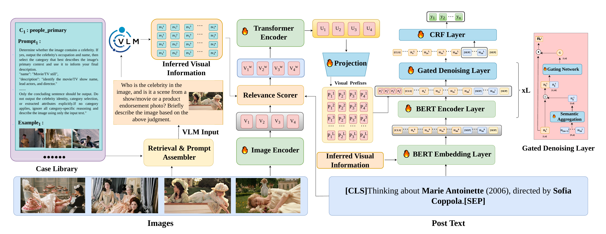

# IVS-MNER: Beyond Visual Appearance

**Modeling Implicit Visual Semantics for Multi-Image Multimodal Named Entity Recognition**

This repository accompanies *Beyond Visual Appearance: Modeling Implicit Visual Semantics for Multi-Image Multimodal Named Entity Recognition*, accepted as a full paper at MMM 2027. IVS-MNER combines inferred visual information with multi-image multimodal named entity recognition (MNER). Relevance Weighting (RW) adjusts each image's contribution, and Semantic Consistency Gating (SCG) limits the effect of inferred information that conflicts with the post text.



| Dataset | F1 reported in the paper |
| --- | ---: |
| MNER-MI | 81.26% |
| MNER-MI-Plus | 85.93% |

## Contents

```text
IVS-MNER/
├── README.md
├── assets/framework.png
├── run.py
├── ner_evaluate.py
├── models/
│   ├── BERTModels_Gated.py
│   └── PT_Bert.py
├── modules/
│   ├── dataset.py
│   └── trainer.py
└── dataset/text/
    ├── MNER-MI-withIS_{train,val,test}.txt
    └── MNER-MI_plus-withIS_{train,val,test}.txt
```

The repository includes the text splits and precomputed auxiliary information. It does not redistribute the benchmark images, pretrained model weights, or the hosted visual language model.

## Data

The `.txt` files contain one JSON record per line. Each record includes the post text, associated image filenames, entity labels, and precomputed visual information.

Download the original MNER-MI images from the [MNER-MI project](https://github.com/JinFish/MNER-MI). Its README lists this [Baidu Netdisk link](https://pan.baidu.com/s/1e3OZ8nGIUaOmEK5nrS8NSA?pwd=bxq1) (extraction code `bxq1`), with `images.zip` for MNER-MI and `twitter2017_images.zip` for the Twitter-2017 images used in MNER-MI-Plus. Extract the image files as follows:

```text
dataset/
├── text/                      # provided here
├── images/                    # extracted images.zip
└── twitter2017_images/        # extracted twitter2017_images.zip
```

## Pretrained models and dependencies

Download [BERT-base-uncased](https://huggingface.co/google-bert/bert-base-uncased) and [ViT-base-patch16-224](https://huggingface.co/google/vit-base-patch16-224) into `pretrained_models/bert-base-uncased/` and `pretrained_models/ViTB-16/`, respectively, or pass their paths with `--bert_model` and `--vit_model`.

The training code imports PyTorch, Transformers, `pytorch-crf` (`torchcrf`), Pillow, NumPy, tqdm, and seqeval. The paper uses [CLIP-ViT-B/32](https://huggingface.co/openai/clip-vit-base-patch32) for case retrieval and Qwen-VL-Plus to generate the visual information already included in the provided text files; neither is called by `run.py`.

## Training

For the MNER-MI files provided here, the training entry point is:

```bash
python run.py \
  --dataset MI-withIS \
  --data_path ./dataset/text \
  --image_path ./dataset/images \
  --bert_model ./pretrained_models/bert-base-uncased \
  --vit_model ./pretrained_models/ViTB-16
```

The script selects `MNER-MI-withIS_train.txt`, `MNER-MI-withIS_val.txt`, and `MNER-MI-withIS_test.txt`, writes `logs/log.txt`, and saves the checkpoint with the best validation result as `model.pt`. Use `CUDA_VISIBLE_DEVICES=0` (or another device index) in your shell to select a GPU. The script accepts `--batch_size`, `--lr`, `--num_epochs`, and `--seed`.

## Acknowledgements and citation

This repository uses the [MNER-MI benchmark and TPM-MI implementation](https://github.com/JinFish/MNER-MI). Please cite the original dataset paper when using its data. If you use IVS-MNER, please cite *Beyond Visual Appearance: Modeling Implicit Visual Semantics for Multi-Image Multimodal Named Entity Recognition* (MMM 2027). The official proceedings citation and DOI can be added after publication.
